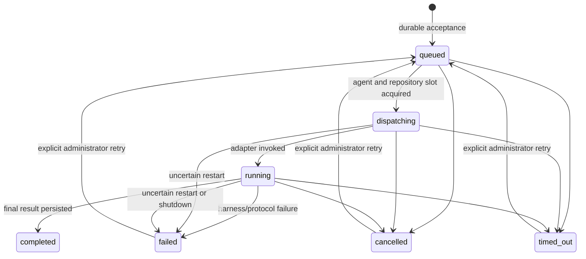

# Protocol and delivery semantics

All domain records expose `schemaVersion: 1`. IDs are random 128-bit hexadecimal values; timestamps are UTC RFC3339. Native harness session IDs are opaque, not agent IDs. See [cli.md](cli.md) for endpoint syntax.

## Admission and addressing

`send` and `request` return the durable task immediately, including `messageId`, `taskId` and `correlationId`. Neither waits on a harness turn. The queued event is the transport acknowledgement: the task and acceptance event have committed in the same SQLite transaction. It does **not** mean that a model accepted or finished a turn.

The destination is one exact canonical `<harness>:<name>` identity. There is no name/model-based fallback. A registered or stopped destination retains its inbox; it must be started explicitly. Deadlines include offline and queued time. The relay permits 128 outstanding tasks per destination and 4096 globally. Text is nonempty UTF-8, at most 64 KiB; results at most 256 KiB. Individual streamed event data is capped at 16 KiB with an explicit truncation marker; at most 10000 adapter progress events per attempt are retained. Events and results are untrusted data, never relay instructions.

Each agent runs one turn at a time in FIFO admission order. All tasks take a repository lock, even if they appear read-only: natural-language instructions cannot be trusted to declare their write set. Sibling agents in the same Git root serialize; outside Git, the canonical working directory is the lock key. This lock only coordinates Meshra, not external editors or unrelated processes. Overlapping non-Git working directories must use the same configured root to be coordinated.

## State transitions

A terminal state is not overwritten by late output or a late successful return. Cancellation is a request to terminate execution, not a rollback of external side effects. A retry is refused while the previous invocation is still stopping. At most three execution attempts per task are allowed. Explicit retries retain the task/correlation IDs and event history, clear the result/error, and assign a fresh 300-second deadline.

## Deduplication and recovery

A nonempty `idempotencyKey` is unique within `(sender identity, sender native session)`. Repeated admission with the same destination, type, text and parent task returns the original task. Reusing a key with different work is a conflict. This deduplicates API admission only, **not** a non-idempotent model/tool execution. There is no exactly-once claim.

Queued work survives daemon restart. Agents previously active become `stopped`; explicit start resumes only the saved native session. Tasks recorded as `dispatching` or `running` become `failed` with an uncertain-execution error. They are never replayed automatically. Inspect the native session and external effects before `meshra task retry`. This intentionally conservative policy avoids runaway duplicate writes following WSL shutdown or a lost connection. A lost SSE connection does not cancel the task.

## Replies and delegation

Task metadata captures immutable `from`, `fromSessionId`, `originAgentId`, `originSessionId`, `parentTaskId`, `correlationId`, `hopCount` and `maxHops`. The destination native session is persisted on allocation. Results stay on those task records; they are **not** injected into an arbitrary active terminal/session. If the origin stops, its replies remain available on authenticated task status/event lookup. A session-bound agent credential cannot inspect an unrelated session's tasks. An administrator can inspect recovery state.

Per-turn MCP credentials bind both identity and active task. A nested request automatically inherits its authenticated parent; a caller cannot select another parent. The relay checks delegation permission, parent destination/session ownership, all ancestor identities and hop limits (default four, maximum sixteen). New requests to ancestors are rejected as cycles. `OMP → Claude → Codex → OMP` is therefore two delegated requests followed by a correlated result returning to the original OMP session, not a new request that re-enters an ancestor's busy slot.

Nested request creation and status/event reads do not acquire a turn slot. Agents should issue asynchronous requests and return/yield rather than indefinitely poll while holding a repository lock needed by their child. Same-repository parent/child turns serialize; a parent that waits while retaining that lock will reach its deadline. Different repositories can execute concurrently.

## Events

Events have monotonically increasing database IDs (global across tasks), task ID, type, bounded data and UTC time. Persistent replay reads up to 256 events per page. SSE supports a last-event cursor and follows until terminal state; reconnect from the last received ID. Polling and SSE use the same stored history. Session, progress, approval-required and terminal events are distinguishable from transport acceptance.
