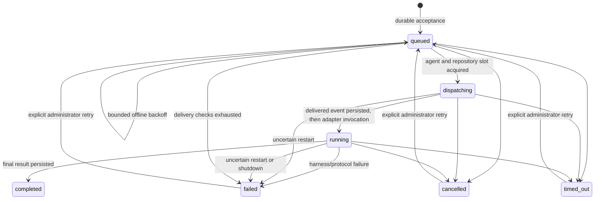

# Protocol and delivery semantics

All domain records expose `schemaVersion: 1`. IDs are random 128-bit hexadecimal values; timestamps are UTC RFC3339. Native harness session IDs are opaque, not agent IDs. See [cli.md](cli.md) for endpoint syntax.

## Admission and addressing

`send` and `request` return the durable task immediately by default, including `messageId`, `taskId` and `correlationId`. `request --wait --timeout DURATION` / `POST /v1/request?wait=true` opt into bounded terminal observation without changing the stored contract. The queued event is the transport acknowledgement: the task and acceptance event have committed in the same SQLite transaction. It does **not** mean that a model accepted or finished a turn.

The destination is one exact canonical `<harness>:<name>` identity. There is no name/model-based fallback. A registered or stopped destination retains its inbox; it must be started explicitly. Deadlines include offline and queued time. The relay permits 128 outstanding tasks per destination and 4096 globally, returning 429 without enqueueing on overload. Text is nonempty UTF-8, at most 64 KiB; results at most 256 KiB. Recognized credentials are redacted before persistence and dispatch; never send credentials. Individual streamed event data is capped at 16 KiB with an explicit truncation marker; at most 10000 adapter events per attempt are retained. Events and results are untrusted data, never relay instructions.

Each agent runs one turn at a time in FIFO admission order, with at most 32 active turns globally. All tasks take a repository lock, even if they appear read-only: natural-language instructions cannot be trusted to declare their write set. Sibling agents in the same Git root serialize; outside Git, the canonical working directory is the lock key. This lock only coordinates Meshra, not external editors or unrelated processes. Overlapping non-Git working directories must use the same configured root to be coordinated.

## State transitions

A terminal state is not overwritten by late output or a late successful return. Cancellation is a request to terminate execution, not a rollback of external side effects. A retry is refused while the previous invocation is still stopping. At most three execution attempts per task are allowed. Explicit retries retain the task/correlation IDs and event history, clear the result/error, and assign a fresh 300-second deadline.

`dispatching` is the compatibility name for a durable claim. `leaseOwner` identifies the owning daemon and `leaseUntil` is the task deadline; an expired lease never grants permission to overlap a still-running invocation. `delivered` acknowledges handoff to the owned adapter, not receipt by a remote provider or execution completion. `attempts` counts turn-slot admissions; `deliveryAttempts` counts offline checks and never implies external execution. `maxAttempts` defaults to three. `nextAttemptAt` persists retry eligibility across restart. The allowed state transitions are validated in the same transaction that persists the task and event.

Offline destinations use equal-jitter exponential backoff: delay is in `[min(base*2^(n-1),cap)/2, min(base*2^(n-1),cap)]`, defaults base 1s/cap 30s, maximum 16 checks. Exhaustion yields `failed`, `errorCategory:"delivery_exhausted"`, `ambiguous:false`. A deadline can terminate earlier. Busy session/repository/global-slot contention does not consume offline checks. An explicit agent start wakes its queued work immediately, bypassing an old offline retry delay. No automatic retry invokes a harness that might already have executed.

## Deduplication and recovery

A nonempty `idempotencyKey` is unique within `(sender identity, sender native session, operation)`. Repeated admission with the same destination, type, text and parent task returns the original task. Reusing a key with different work is a conflict. Request fingerprints are computed before credential redaction so different secret-bearing requests do not collapse to the same redacted request. The retention window is the lifetime of the task: active work is retained, terminal history defaults to 30 days after its last update, and ancestors needed by retained work are protected. Pruning atomically removes events and the task; its key can then be reused. This deduplicates API admission only, **not** a non-idempotent model/tool execution. There is no exactly-once claim.

Queued work survives daemon restart. Agents previously active become `stopped`; explicit start resumes only the saved native session. Tasks recorded as `dispatching` or `running` become `failed` with an uncertain-execution error. They are never replayed automatically. Inspect the native session and external effects before `meshra task retry`. This intentionally conservative policy avoids runaway duplicate writes following WSL shutdown or a lost connection. A lost SSE connection does not cancel the task.

`errorCategory` distinguishes `destination_offline`, `delivery_exhausted`, `credential_unavailable`, `deadline_exceeded`, `cancelled`, `adapter_failure`, `response_too_large`, and `uncertain_execution`. Unknown harness errors, interrupted invocations, running timeouts and cancellation of previously dispatched work set `ambiguous:true`. A successful late return does not clear ambiguity or overwrite cancellation. Treat ambiguous results as requiring native-session/external-effect reconciliation before manual retry.

## Replies and delegation

Task metadata captures immutable `from`, `fromSessionId`, `originAgentId`, `originSessionId`, `parentTaskId`, `correlationId`, `hopCount` and `maxHops`. The destination native session is persisted on allocation. Results stay on those task records; they are **not** injected into an arbitrary active terminal/session. If the origin stops, its replies remain available on authenticated task status/event lookup. A session-bound agent credential cannot inspect an unrelated session's tasks. An administrator can inspect recovery state.

Per-turn MCP credentials bind both identity and active task. A nested request automatically inherits its authenticated parent; a caller cannot select another parent. The relay checks delegation permission, parent destination/session ownership, all ancestor identities and hop limits (default four, maximum sixteen). New requests to ancestors are rejected as cycles. `OMP → Claude → Codex → OMP` is therefore two delegated requests followed by a correlated result returning to the original OMP session, not a new request that re-enters an ancestor's busy slot.

A newly admitted child's deadline cannot exceed its parent's persisted deadline. Hop and ancestry checks remain independent of timeout propagation. An explicit administrator retry retains the v0.1 fresh 300-second deadline even for a historical child; this is a human override, not autonomous deadline extension, and does not recompute an already terminal parent's result.

Nested request creation and status/event reads do not acquire a turn slot. Agents should issue asynchronous requests and return/yield rather than indefinitely poll while holding a repository lock needed by their child. Same-repository parent/child turns serialize; a parent that waits while retaining that lock will reach its deadline. Different repositories can execute concurrently.

## Events

Events have monotonically increasing database IDs (global across tasks), task ID, type, bounded data, UTC time, and persisted message/correlation/sender/recipient/harness/session/attempt metadata. Pre-v0.2 events retain original IDs and data (with recognized-credential redaction); missing legacy event metadata is derived from its retained task and cannot reconstruct historical attempt-specific sessions. Persistent replay reads up to 256 events per page. SSE supports `Last-Event-ID` (overrides `after`) and follows until terminal state; reconnect from the last fully processed ID. Polling and SSE use the same stored history. Session, progress, approval-required and terminal events are distinguishable from transport acceptance.

`task trace` returns the latest 256 retained events with each data field limited to 2048 bytes, plus the complete Task and `eventsTruncated`. Use paginated `task events --after N` for the complete retained history and original bounded data. Sequence gaps from other tasks or pruning are normal. An expired task returns 404; retention does not silently switch a subscriber to another identity's history. Retention runs at startup and hourly; expired data is eligible for removal, not guaranteed to disappear at an exact second.

Timers use absolute persisted deadlines/retry times, recomputing their remaining interval after scheduling work. SQLite or process scheduling can still delay the durable terminal transition; synchronous waiting returns the latest nonterminal task with HTTP 202 rather than inventing completion. This local service is not a hard real-time deadline executor.
